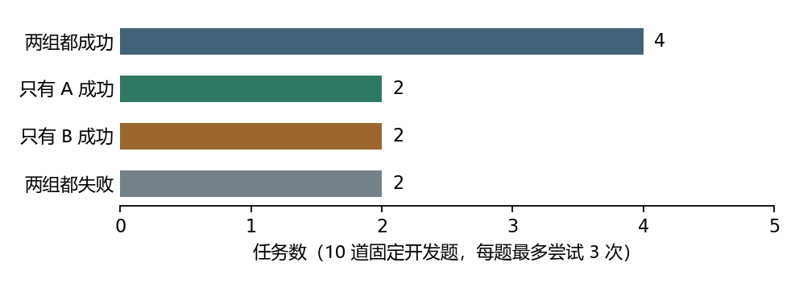

# R00 · 十题基线复核 | 2026-11-22

**决定建议**　优先试验“引用观察、只给一个纠错动作”的 C 提示词。现有数据能说明值得试，尚无 C 的测量结果。

| 开发集指标 | A 无反思 | B 原始反思 |
| --- | ---: | ---: |
| 首次成功 | 4/10 | 4/10 |
| 三次内成功 | 6/10 | 6/10 |
| 首败后恢复 | 2/6 | 2/6 |
| 调用数 / 后端推理秒 | 566 / 190.79 | 547 / 223.43 |

B 帮上忙的候选案例是放书和清洁黄油刀，A 独有的是冷却盘子和灯下检查 CD。B 后端推理耗时高 17.1%。CD 题第一次尝试的第 11 个动作已拿到 CD，反思却说没找到。B 的 10 条反思全部触及 256 token 上限。下一步可检验短提示能否同时改善事实准确性和重试成功率。

**独立的 Anchor 对照**　同一动作策略下，筛选与不筛选均为 0/10，各执行 900 步，拿取均为 0 次。两组都使用了笔记。空库对照才能检验笔记是否影响拿取。

**复核口径**　使用历史运行的固定十题。图中逐题取三次尝试内是否成功，再按任务 ID 配对。推理秒取自模型后端，学校计费卡时待核。一次开发集运行无法估计跨种子稳定性。

| 证据 | 运行与定位 |
| --- | --- |
| A/B · 提交 `9b3ca7b` | [汇总与逐题 attempts](../../logs/m1-dev-ab-20261110/summary.json) · [配置、任务与版本](../../logs/m1-dev-ab-20261110/manifest.json) · [轨迹](../../logs/m1-dev-ab-20261110/trace.jsonl)，筛选 B、CD、attempt=1 的 environment_step 和 reflection |
| Anchor · 提交 `0547e3f` | [分组汇总](../../logs/anchor-attempt1-dev/summary.json) · [运行清单](../../logs/anchor-attempt1-dev/manifest.json) · [轨迹](../../logs/anchor-attempt1-dev/trace.jsonl)，按 condition 统计 environment_step 中以 take 开头的 action |

本次从已有日志重新计数，新增实验 GPU 用量为 0。后续方向与状态见[研究计划](../planning/plan.md)。
